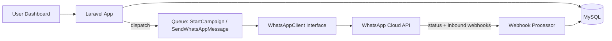
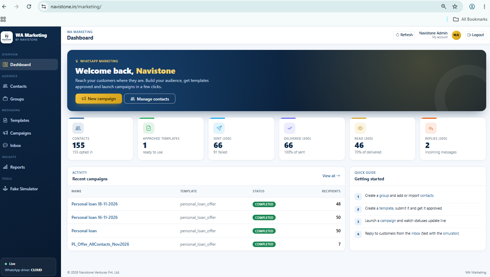

# WhatsApp Marketing Platform

> Bulk WhatsApp campaign & customer messaging platform built on the **WhatsApp Cloud API**.
> 🔒 Built for [Company / "a client"] — currently in production. Source code is proprietary; this repo showcases the architecture and features.

## 🚀 Features
- **Contact management**: CRUD, CSV bulk import, grouping/segmentation
- **Message templates**: create, submit to Meta for approval, sync approval status
- **Campaigns**: bulk sends to groups, queued delivery, cancel mid-run, live stats
- **Delivery tracking**: sent / delivered / read / failed via WhatsApp webhooks
- **Two-way inbox**: view incoming customer replies and respond in real time
- **Reports**: campaign analytics with CSV export
- **Simulator mode**: fake WhatsApp client + webhook simulator for safe local testing

## 🛠 Tech Stack
PHP 8.2 · Laravel 11 · MySQL · Laravel Queues & Jobs · WhatsApp Cloud API (Meta Graph API) · Blade · Vite

## 🏗 Architecture

## 💡 Key Engineering Decisions
- **Client interface pattern**: `WhatsAppClient` with a real Cloud API implementation and a fake one, so the whole system can be tested without sending real messages.
- **Queue-based sending**: campaigns are split into per-message jobs for throughput, retries and rate-limit safety.
- **Webhook processing**: verifies Meta's webhook, logs raw payloads and updates message status idempotently.

## 📸 Screenshots
| Dashboard | Campaign Stats |
|---|---|
|  |  |
| Inbox | Templates |
|  |  |

## 👩‍💻 My Role
[e.g. Sole developer: designed the database, built the backend, WhatsApp integration, queues and deployment.]

## 📬 Contact
[LinkedIn] · [Email]
