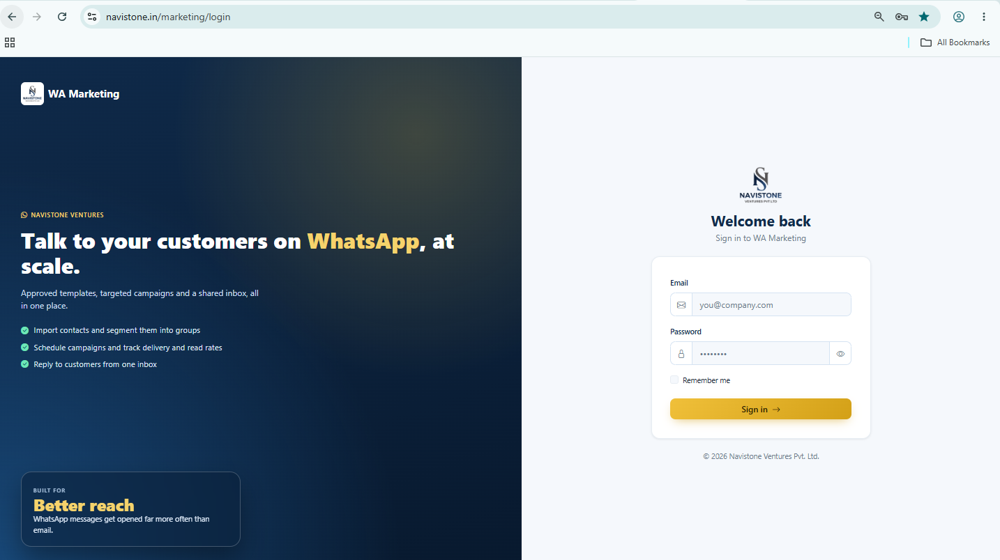
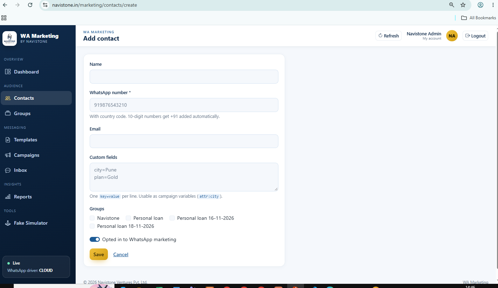
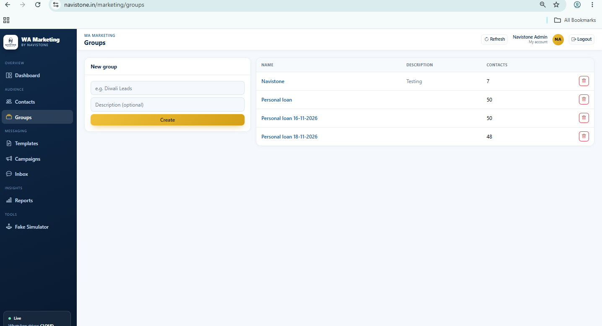
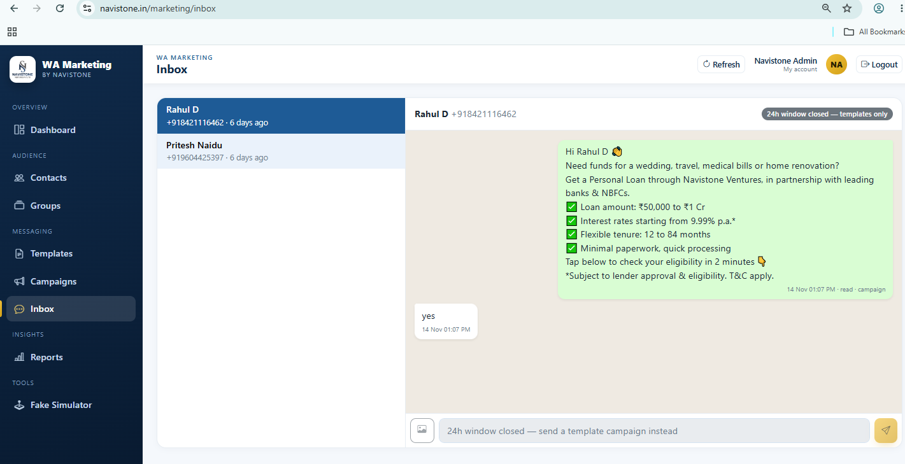
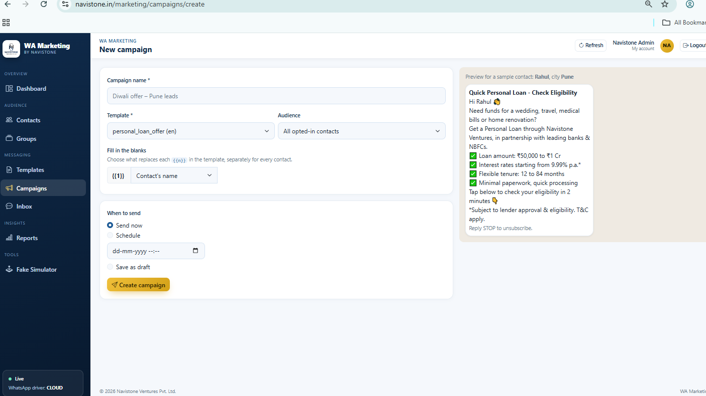
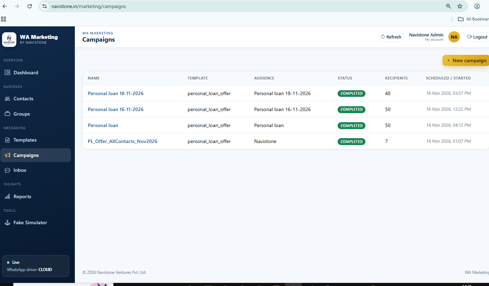
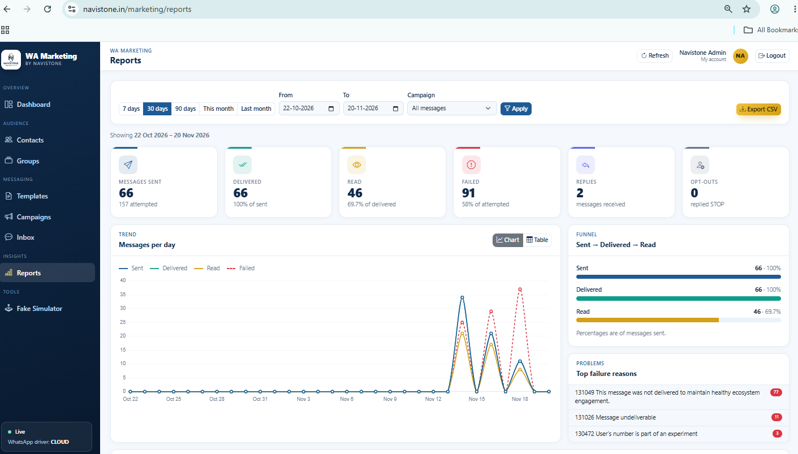

# WhatsApp Marketing & Campaign Management System
URL: https://navistone.in/marketing/
A complete **WhatsApp Bulk Marketing + Customer Messaging Platform** built with **Laravel 11** and the official **WhatsApp Cloud API (Meta)**. It lets businesses manage contacts, create Meta-approved message templates, run **bulk campaigns** to customer groups, track **real-time delivery status**, and chat with customers through a **two-way inbox**.

> ℹ️ **Note:** This repository is a **project showcase**. The application is running in production for a company, so the source code is not public. Screenshots use dummy data.

---

## 📸 Screenshots

| Login | Dashboard |
|---|---|
|  |  |

| Contacts | Contact Groups |
|---|---|
|  |  |

| Message Templates | Create Campaign |
|---|---|
|  |  |

| Campaign Statistics | Inbox |
|---|---|
|  |  |

| Reports |
|---|
|  |

---

## ✨ Key Features

### 📊 Dashboard
- Overview of **total contacts, campaigns, messages sent, delivered & read**
- Recent campaign activity at a glance

### 👥 Contact Management
- Add · Edit · Delete contacts
- **Bulk import from CSV** with a downloadable sample file
- Organise contacts into **groups** for targeted campaigns

### 📝 Message Templates
- Create WhatsApp message templates with variables
- **Submit templates to Meta for approval** directly from the app
- **Sync approval status** (Pending · Approved · Rejected)

### 🚀 Bulk Campaigns
- Send approved templates to one or more contact groups
- **Queue-based background sending**, so large campaigns don't slow the app
- **Cancel** a campaign while it is running
- Live campaign stats: **Sent · Delivered · Read · Failed**

### 💬 Two-Way Inbox
- View **incoming customer replies** in real time
- **Reply to customers** directly from the inbox
- Full conversation history per contact

### 🔔 Webhook Integration
- Verified **WhatsApp Cloud API webhook** endpoint
- Automatic message **status updates** (sent → delivered → read / failed)
- Inbound messages saved automatically
- Raw webhook logs kept for debugging

### 📈 Reports
- Campaign-wise delivery & engagement reports
- **Export reports to CSV**

### 🧪 Simulator / Test Mode
- Built-in **fake WhatsApp client** and **webhook simulator**
- Test campaigns, inbound messages and template approvals **without sending real messages**

---

## ⚙️ How It Works

| Step | Process |
|---|---|
| 1 | **Import contacts** and organise them into groups |
| 2 | **Create a template** and submit it to Meta for approval |
| 3 | **Create a campaign** by selecting an approved template and target groups |
| 4 | Campaign is **queued**; each message is sent as a background job |
| 5 | **WhatsApp webhooks** update each message's delivery status |
| 6 | Customer replies arrive in the **Inbox**; results appear in **Reports** |

---

## 🛠 Tech Stack

| Layer | Technology |
|---|---|
| Backend | PHP 8.2 · Laravel 11 |
| Database | MySQL |
| Frontend | Blade · CSS · JavaScript · Vite |
| Messaging API | WhatsApp Cloud API (Meta Graph API) |
| Background Processing | Laravel Queues & Jobs |
| Integrations | Webhooks · CSV Import/Export |
| Authentication | Laravel Auth |

---

## 🧩 Modules at a Glance

```
WhatsApp Marketing System
├── Authentication
├── Dashboard
├── Account Settings
├── Contacts
│   ├── CSV Import
│   └── Groups
├── Templates
│   ├── Submit to Meta
│   └── Sync Approval Status
├── Campaigns
│   ├── Queue-based Sending
│   ├── Live Statistics
│   └── Cancel Campaign
├── Inbox (Two-way Chat)
├── Reports & CSV Export
├── Webhook Processor
└── Simulator (Test Mode)
```

---

## 👩‍💻 Author

**Manjushree C**
- GitHub: [@manjushree-c](https://github.com/manjushree-c)
- LinkedIn: [https://www.linkedin.com/in/manjushree-chabukswar-920102147/]

---

© 2026 All rights reserved. This project is proprietary; source code is not publicly available.
